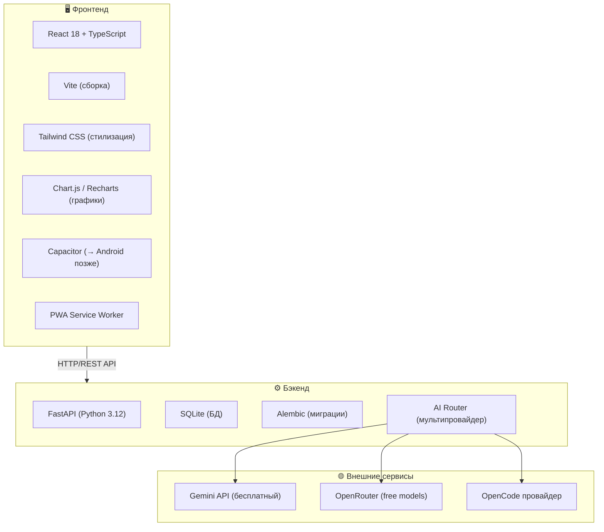
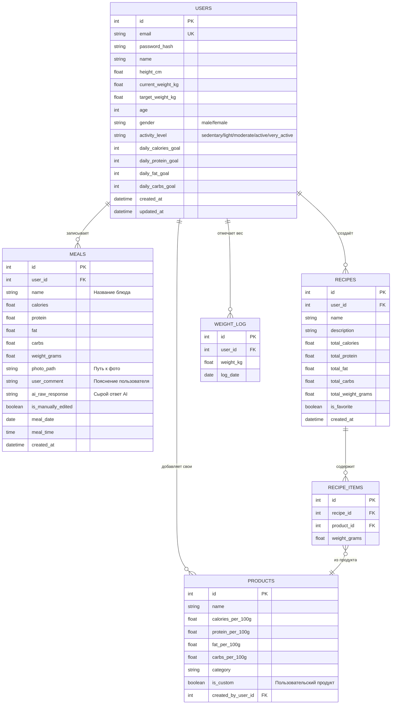
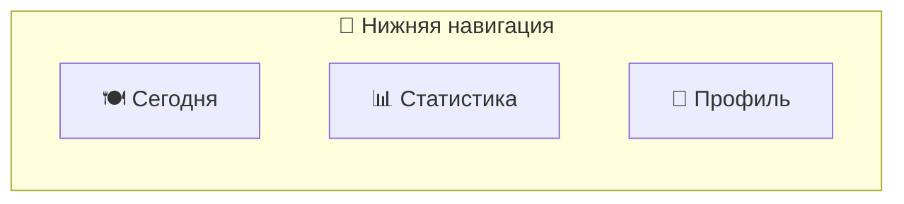
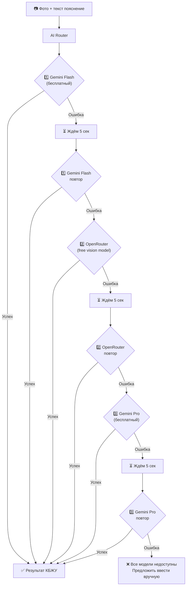
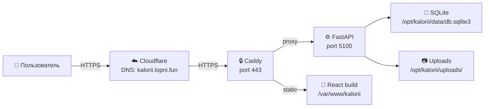

# 📋 KaloriiAI — Полный план архитектуры

> Веб-приложение для подсчёта калорий и макронутриентов (КБЖУ) с распознаванием еды по фото через AI.

---

## 1. Общая информация

| Параметр | Значение |
|---|---|
| **Название** | KaloriiAI |
| **Тип** | PWA веб-приложение (Progressive Web App) |
| **Аудитория** | 1–3 пользователя (личное использование) |
| **Язык интерфейса** | Русский (с архитектурой под добавление i18n позже) |
| **Тема** | Тёмная (dark mode) |
| **Адаптивность** | Mobile-first + полная адаптивность десктоп |
| **Домен** | `kalorii.lopni.fun` (HTTPS через Caddy + Cloudflare) |
| **Сервер** | 62.60.186.12 (Швеция, Ubuntu 26.04, 1 CPU / 3.8G RAM) |
| **Будущее** | Упаковка в Android-приложение через Capacitor |

---

## 2. Технологический стек



### Почему этот стек

| Компонент | Выбор | Причина |
|---|---|---|
| **Фронтенд** | **React + TypeScript** | Лучшая поддержка Capacitor для упаковки в Android; огромная экосистема; TypeScript для надёжности |
| **Сборщик** | **Vite** | Молниеносная сборка, HMR, отличная поддержка React + TS |
| **CSS** | **Tailwind CSS** | Быстрая стилизация тёмной темы, утилитарный подход, mobile-first из коробки |
| **Бэкенд** | **FastAPI** | Async Python, автодокументация API (Swagger), быстрый, отличная работа с файлами |
| **БД** | **SQLite** | Один файл, без отдельного сервиса, идеально для 1–3 пользователей, легко бэкапить |
| **Миграции** | **Alembic** | Стандарт для SQLAlchemy, версионирование схемы БД |
| **Графики** | **Recharts** | React-нативные графики, красивые анимации, адаптивность |
| **Мобильное** | **Capacitor** | Обернёт веб-приложение в нативный Android APK без переписывания |

---

## 3. Архитектура приложения

### 3.1. Структура проекта

```
KALORII/
├── backend/                    # Python FastAPI бэкенд
│   ├── app/
│   │   ├── __init__.py
│   │   ├── main.py             # Точка входа FastAPI
│   │   ├── config.py           # Настройки приложения
│   │   ├── database.py         # SQLite подключение + SQLAlchemy
│   │   ├── models/             # ORM модели
│   │   │   ├── user.py
│   │   │   ├── meal.py
│   │   │   ├── product.py
│   │   │   └── recipe.py
│   │   ├── schemas/            # Pydantic схемы
│   │   │   ├── user.py
│   │   │   ├── meal.py
│   │   │   ├── product.py
│   │   │   └── ai.py
│   │   ├── routers/            # API эндпоинты
│   │   │   ├── auth.py         # Регистрация / логин
│   │   │   ├── meals.py        # CRUD приёмов пищи
│   │   │   ├── products.py     # База продуктов
│   │   │   ├── recipes.py      # Рецепты + избранное
│   │   │   ├── stats.py        # Статистика
│   │   │   ├── profile.py      # Профиль / настройки
│   │   │   └── ai.py           # AI распознавание
│   │   ├── services/           # Бизнес-логика
│   │   │   ├── ai_router.py    # Мультипровайдер AI с fallback
│   │   │   ├── nutrition.py    # Расчёт КБЖУ нормы
│   │   │   └── auth.py         # JWT токены, хеширование
│   │   └── utils/
│   │       ├── ai_providers/   # Адаптеры провайдеров
│   │       │   ├── gemini.py
│   │       │   ├── openrouter.py
│   │       │   └── base.py
│   │       └── image.py        # Обработка/сжатие фото
│   ├── alembic/                # Миграции БД
│   ├── data/
│   │   └── products_seed.json  # Начальная база продуктов
│   ├── uploads/                # Загруженные фото (на сервере)
│   ├── requirements.txt
│   └── alembic.ini
│
├── frontend/                   # React фронтенд
│   ├── src/
│   │   ├── main.tsx
│   │   ├── App.tsx
│   │   ├── api/                # HTTP-клиент к бэкенду
│   │   │   └── client.ts
│   │   ├── components/         # UI компоненты
│   │   │   ├── layout/         # Layout, BottomNav, Header
│   │   │   ├── meals/          # Карточки еды, список
│   │   │   ├── stats/          # Графики, диаграммы
│   │   │   ├── ai/             # Камера, загрузка фото, результат
│   │   │   ├── products/       # Поиск продуктов, избранное
│   │   │   └── ui/             # Базовые UI элементы
│   │   ├── pages/              # Страницы приложения
│   │   │   ├── TodayPage.tsx   # Главная — сегодняшняя еда
│   │   │   ├── StatsPage.tsx   # Статистика
│   │   │   ├── ProfilePage.tsx # Профиль и настройки
│   │   │   ├── LoginPage.tsx
│   │   │   └── RegisterPage.tsx
│   │   ├── hooks/              # React хуки
│   │   ├── store/              # Zustand стейт-менеджер
│   │   ├── types/              # TypeScript типы
│   │   └── utils/
│   ├── public/
│   │   ├── manifest.json       # PWA манифест
│   │   └── sw.js               # Service Worker
│   ├── index.html
│   ├── tailwind.config.ts
│   ├── vite.config.ts
│   ├── tsconfig.json
│   └── package.json
│
├── deploy/                     # Деплой на сервер
│   ├── Caddyfile.kalorii       # Конфиг Caddy для поддомена
│   ├── kalorii.service         # systemd unit для бэкенда
│   └── deploy.sh               # Скрипт деплоя
│
└── README.md
```

### 3.2. Схема базы данных



---

## 4. Экраны приложения (UI/UX)

### 4.1. Навигация (нижняя панель — 3 вкладки)



### 4.2. Экран «Сегодня» (главный)

Основной экран, который пользователь видит при открытии:

```
┌─────────────────────────────────┐
│  KaloriiAI        📅 13 окт    │
├─────────────────────────────────┤
│                                 │
│  ╔═══════════════════════════╗  │
│  ║  🔥 1450 / 2200 ккал     ║  │
│  ║  ████████████░░░░░  66%  ║  │
│  ║                           ║  │
│  ║  Б: 85/140г  Ж: 52/73г   ║  │
│  ║  У: 160/275г              ║  │
│  ╚═══════════════════════════╝  │
│                                 │
│  ── Сегодня ─────────────────── │
│                                 │
│  🍳 Овсянка с бананом    09:30  │
│     320 ккал | Б12 Ж8 У52      │
│     [📷] [✏️]                   │
│                                 │
│  🥗 Куриная грудка с рис 13:15 │
│     520 ккал | Б45 Ж12 У58     │
│     [📷] [✏️]                   │
│                                 │
│  🍎 Яблоко              16:00  │
│     95 ккал | Б0 Ж0 У25        │
│     [✏️]                        │
│                                 │
│            ┌──────────┐         │
│            │  ＋ 📷   │         │
│            │ Добавить │         │
│            └──────────┘         │
│                                 │
├──────┬──────────┬───────────────┤
│ 🍽️  │   📊    │     👤       │
│Сегодня│Статистика│   Профиль   │
└──────┴──────────┴───────────────┘
```

**Функционал экрана «Сегодня»:**
- Кольцевой прогресс-бар калорий за день (потреблено / цель)
- Мини-бары Б/Ж/У (потреблено / цель)
- Хронологический список всего съеденного за день
- Каждый элемент: название, время, КБЖУ, иконка фото (если есть), кнопка редактирования
- Большая кнопка «+ Добавить» → открывает диалог добавления еды
- Свайп по дате (или стрелки) для просмотра предыдущих дней

### 4.3. Диалог добавления еды

```
┌─────────────────────────────────┐
│  Добавить еду            ✕     │
├─────────────────────────────────┤
│                                 │
│  ┌─────────┐  ┌─────────┐      │
│  │  📷     │  │  🖼️     │      │
│  │ Камера  │  │ Галерея │      │
│  └─────────┘  └─────────┘      │
│                                 │
│  Пояснение к фото (опционально)│
│  ┌─────────────────────────┐   │
│  │ "Гречка с курицей,     │   │
│  │  примерно 300г"         │   │
│  └─────────────────────────┘   │
│                                 │
│  ──── или ────                  │
│                                 │
│  🔍 Поиск продукта...          │
│  ⭐ Избранные рецепты           │
│  📝 Ввести КБЖУ вручную        │
│                                 │
│         [ Распознать 🤖 ]       │
│                                 │
└─────────────────────────────────┘
```

**Три способа добавить еду:**
1. **📷 Фото + AI** — сфотографировать / загрузить из галереи → AI определяет КБЖУ → пользователь может отредактировать результат
2. **🔍 Из базы продуктов** — поиск по названию, указать граммы
3. **📝 Вручную** — ввести название + КБЖУ руками

### 4.4. Экран результата AI распознавания

```
┌─────────────────────────────────┐
│  Результат распознавания  ✕    │
├─────────────────────────────────┤
│                                 │
│  ┌───────────────────────┐     │
│  │     [фото еды]        │     │
│  └───────────────────────┘     │
│                                 │
│  🤖 AI определил:               │
│                                 │
│  Название: [Гречка с курицей]  │
│  Вес:      [300         ] г    │
│  Калории:  [345         ] ккал │
│  Белки:    [38          ] г    │
│  Жиры:     [8           ] г    │
│  Углеводы: [42          ] г    │
│                                 │
│  ⚠️ Все поля редактируемые      │
│                                 │
│  ┌─────────┐ ┌──────────┐     │
│  │ Отмена  │ │ Сохранить│     │
│  └─────────┘ └──────────┘     │
│                                 │
└─────────────────────────────────┘
```

### 4.5. Экран «Статистика»

Пользователь выбирает период и тип визуализации:

**Виды графиков (все доступны, пользователь выбирает):**
- 📊 **Столбчатая диаграмма** — калории по дням/неделям/месяцам
- 📈 **Линейный график** — тренд калорий за период
- 🍩 **Кольцевая диаграмма** — соотношение Б/Ж/У за выбранный период
- 💪 **Прогресс-кольца** (Apple Health стиль) — дневные цели ккал/Б/Ж/У
- ⚖️ **Тренд веса** — линейный график изменения веса во времени
- 📋 **Таблица** — детальная таблица по дням с числами
- 🎯 **Достижение целей** — % дней когда цели были выполнены

**Периоды:** Сегодня / 7 дней / 30 дней / Произвольный диапазон

### 4.6. Экран «Профиль»

```
┌─────────────────────────────────┐
│  Профиль               🚪      │
├─────────────────────────────────┤
│                                 │
│  📧 email@example.com           │
│  👤 Имя: Бектемир                │
│                                 │
│  ── Параметры тела ──────────── │
│  Рост:         [175    ] см    │
│  Текущий вес:  [80     ] кг    │
│  Целевой вес:  [72     ] кг    │
│  Возраст:      [25     ]       │
│  Пол:          [М / Ж]        │
│  Активность:   [▼ Умеренная]   │
│                                 │
│  ── Цели КБЖУ ───────────────── │
│  🔥 Калории:  [2200] ккал/день  │
│  💪 Белки:    [140 ] г/день    │
│  🧈 Жиры:    [73  ] г/день    │
│  🍞 Углеводы: [275 ] г/день    │
│                                 │
│  [🧮 Рассчитать автоматически]  │
│  (формула Mifflin-St Jeor)     │
│                                 │
│  ── Журнал веса ─────────────── │
│  ⚖️ Записать вес сегодня        │
│                                 │
│  ── Настройки ───────────────── │
│  🌐 Язык: Русский               │
│                                 │
│         [ Сохранить ]           │
│                                 │
└─────────────────────────────────┘
```

**Авторасчёт нормы КБЖУ** по формуле **Mifflin-St Jeor**:
- Мужчины: BMR = 10 × вес(кг) + 6.25 × рост(см) − 5 × возраст − 161 + 166
- Женщины: BMR = 10 × вес(кг) + 6.25 × рост(см) − 5 × возраст − 161
- Далее × коэффициент активности (1.2–1.9)
- Корректировка на цель (набор/похудение/поддержание)
- Пользователь может подкорректировать результат вручную

---

## 5. AI система распознавания еды

### 5.1. Мультипровайдер с автоматическим fallback



### 5.2. Провайдеры AI (все бесплатные)

| Приоритет | Провайдер | Модель | Vision | Лимиты |
|---|---|---|---|---|
| 1 | **Gemini API** | `gemini-2.0-flash` | ✅ | 15 RPM, 1M TPD (free) |
| 2 | **OpenRouter** | Free vision модели (meta-llama, qwen-vl и др.) | ✅ | Зависит от модели |
| 3 | **Gemini API** | `gemini-1.5-pro` | ✅ | 2 RPM (free) |
| 4 | **OpenRouter** | Альтернативные free vision модели | ✅ | Fallback |

### 5.3. Промпт для AI

```
Ты — эксперт-нутрициолог. Проанализируй фото еды и определи:
1. Название блюда/продукта
2. Примерный вес порции в граммах
3. Калории (ккал)
4. Белки (г)
5. Жиры (г)
6. Углеводы (г)

{user_comment ? "Пояснение пользователя: " + user_comment : ""}

Ответь СТРОГО в JSON формате:
{
  "name": "название",
  "weight_grams": число,
  "calories": число,
  "protein": число,
  "fat": число,
  "carbs": число,
  "confidence": "high/medium/low"
}
```

### 5.4. Логика retry

```python
# Псевдокод AI Router
async def recognize_food(image, comment=None):
    providers = [GeminiFlash, OpenRouterFree, GeminiPro, OpenRouterAlt]

    for provider in providers:
        for attempt in range(2):  # 2 попытки на провайдера
            try:
                result = await provider.analyze(image, comment)
                return parse_nutrition(result)
            except (RateLimitError, APIError, TimeoutError):
                if attempt == 0:
                    await asyncio.sleep(5)  # Ждём 5 сек перед повтором
                continue
        # Провайдер не сработал → следующий

    raise AllProvidersFailedError("Все модели недоступны")
```

---

## 6. API эндпоинты

### 6.1. Авторизация

| Метод | Путь | Описание |
|---|---|---|
| POST | `/api/auth/register` | Регистрация (email + пароль) |
| POST | `/api/auth/login` | Логин → JWT токен |
| POST | `/api/auth/refresh` | Обновить JWT токен |
| GET | `/api/auth/me` | Текущий пользователь |

### 6.2. Приёмы пищи

| Метод | Путь | Описание |
|---|---|---|
| GET | `/api/meals?date=2026-10-13` | Список еды за день |
| POST | `/api/meals` | Добавить приём пищи |
| PUT | `/api/meals/{id}` | Редактировать (после AI или вручную) |
| DELETE | `/api/meals/{id}` | Удалить |

### 6.3. AI распознавание

| Метод | Путь | Описание |
|---|---|---|
| POST | `/api/ai/recognize` | Загрузить фото + комментарий → КБЖУ |

### 6.4. Продукты и рецепты

| Метод | Путь | Описание |
|---|---|---|
| GET | `/api/products?search=куриц` | Поиск продуктов |
| POST | `/api/products` | Добавить свой продукт |
| GET | `/api/recipes` | Мои рецепты |
| POST | `/api/recipes` | Создать рецепт |
| PUT | `/api/recipes/{id}/favorite` | В избранное / убрать |

### 6.5. Статистика и профиль

| Метод | Путь | Описание |
|---|---|---|
| GET | `/api/stats?period=week` | Статистика за период |
| GET | `/api/stats/weight` | Журнал веса |
| GET | `/api/profile` | Получить профиль |
| PUT | `/api/profile` | Обновить профиль / цели |
| POST | `/api/profile/calculate` | Авторасчёт нормы КБЖУ |
| POST | `/api/profile/weight` | Записать вес |

---

## 7. Инфраструктура и деплой

### 7.1. Сервер 62.60.186.12 (Швеция)



### 7.2. Порты

| Сервис | Порт | Статус |
|---|---|---|
| Caddy (HTTP → HTTPS) | 80, 443 | ✅ Уже занят (добавим поддомен) |
| VPN (VLESS, Trojan, SS) | 2053, 2222, 8443, 39851 | ✅ Занят VPN |
| **KaloriiAI Backend** | **5100** | 🆕 Свободен |

> [!IMPORTANT]
> Порт 5100 выбран как незанятый. Бэкенд слушает на `127.0.0.1:5100` (только localhost), а наружу выставляется через Caddy reverse proxy по HTTPS.

### 7.3. Конфигурация Caddy

В существующий Caddyfile на сервере добавляется блок:

```caddyfile
kalorii.lopni.fun {
    # Статический фронтенд
    root * /var/www/kalorii
    file_server

    # API → FastAPI бэкенд
    handle /api/* {
        reverse_proxy 127.0.0.1:5100
    }

    # SPA fallback (React Router)
    try_files {path} /index.html

    # HTTPS автоматически через Caddy (ACME)
    tls {
        dns cloudflare {env.CF_API_TOKEN}
    }
}
```

### 7.4. Cloudflare DNS

Создать DNS-запись:
- **Тип:** A
- **Имя:** `kalorii`
- **Содержимое:** `62.60.186.12`
- **Прокси:** DNS only (серое облако) — чтобы Caddy сам управлял TLS

> [!NOTE]
> Cloudflare API-токен для DNS challenge лежит на RU-сервере в `/root/.secrets/cloudflare.ini`. Нужно либо скопировать его на SW-сервер, либо использовать Caddy с DNS challenge через Cloudflare модуль.

### 7.5. Systemd сервис

```ini
[Unit]
Description=KaloriiAI Backend
After=network.target

[Service]
Type=simple
User=kalorii
WorkingDirectory=/opt/kalorii/backend
ExecStart=/opt/kalorii/venv/bin/uvicorn app.main:app --host 127.0.0.1 --port 5100
Restart=always
RestartSec=5
Environment=PYTHONPATH=/opt/kalorii/backend

[Install]
WantedBy=multi-user.target
```

### 7.6. Структура на сервере

```
/opt/kalorii/
├── backend/          # Код бэкенда
├── venv/             # Python virtualenv
├── data/
│   └── db.sqlite3    # База данных
├── uploads/          # Загруженные фото
└── .env              # Секреты (API ключи, JWT secret)

/var/www/kalorii/     # Собранный React фронтенд (build)
```

---

## 8. Безопасность

| Аспект | Решение |
|---|---|
| **Аутентификация** | JWT токены (access + refresh), bcrypt хеширование паролей |
| **HTTPS** | Caddy с автоматическим TLS сертификатом |
| **API ключи AI** | Хранятся в `/opt/kalorii/.env`, не в коде |
| **Загрузка файлов** | Валидация MIME-типа (только image/*), ограничение размера (10MB), сжатие |
| **CORS** | Разрешён только `kalorii.lopni.fun` |
| **Rate limiting** | На эндпоинт AI — max 10 запросов в минуту на пользователя |

---

## 9. План реализации (фазы)

### Фаза 1: Фундамент (MVP) — ~2-3 дня
- [x] Инициализация проектов (backend + frontend)
- [ ] Настройка SQLite + SQLAlchemy + Alembic
- [ ] Модели БД (users, meals, products)
- [ ] Аутентификация (регистрация, логин, JWT)
- [ ] Базовый UI: layout с нижней навигацией, страницы-заглушки
- [ ] Экран логина/регистрации
- [ ] Деплой на сервер (Caddy + systemd)

### Фаза 2: Основной функционал — ~2-3 дня
- [ ] AI Router (Gemini + OpenRouter + retry логика)
- [ ] Загрузка фото (камера + галерея)
- [ ] Экран «Сегодня» — список еды, прогресс-бары
- [ ] Добавление/редактирование/удаление приёмов пищи
- [ ] Результат AI с возможностью редактирования

### Фаза 3: Профиль и расчёты — ~1 день
- [ ] Экран профиля с параметрами тела
- [ ] Авторасчёт КБЖУ (Mifflin-St Jeor)
- [ ] Журнал веса

### Фаза 4: Статистика — ~1-2 дня
- [ ] Графики: столбчатые, линейные, кольцевые
- [ ] Прогресс-кольца (Apple Health стиль)
- [ ] Тренд веса
- [ ] Фильтры по периодам

### Фаза 5: База продуктов и рецепты — ~1-2 дня
- [ ] Сидирование базы продуктов (популярные 200+ продуктов)
- [ ] Поиск продуктов
- [ ] Создание своих продуктов
- [ ] Рецепты (создание, избранное)
- [ ] Добавление еды из базы / рецептов

### Фаза 6: Полировка — ~1 день
- [ ] PWA манифест + Service Worker
- [ ] Offline fallback
- [ ] Анимации и переходы
- [ ] Оптимизация сжатия фото перед отправкой
- [ ] Финальное тестирование

> **Итого: ~8-12 дней** до полностью рабочего приложения

---

## 10. Ключевые решения и компромиссы

| Решение | Обоснование |
|---|---|
| **SQLite вместо PostgreSQL** | На сервере уже есть PostgreSQL для Remnawave. SQLite изолирован, не конфликтует, легко бэкапится (один файл), достаточен для 1-3 юзеров |
| **React + Capacitor** | React → можно обернуть в Android APK через Capacitor без переписывания. Vue + Capacitor тоже вариант, но React лучше поддерживается |
| **Фронтенд как статика** | Caddy отдаёт собранный React build как статические файлы — максимальная производительность, минимум нагрузки |
| **Мультипровайдер AI** | Бесплатные модели часто недоступны — fallback между провайдерами повышает надёжность |
| **Без Docker для KaloriiAI** | Сервер и так нагружен Docker-контейнерами VPN. KaloriiAI — простой Python + статика, достаточно systemd |
| **Порт 5100** | Далеко от стандартных портов, не конфликтует с VPN сервисами |
