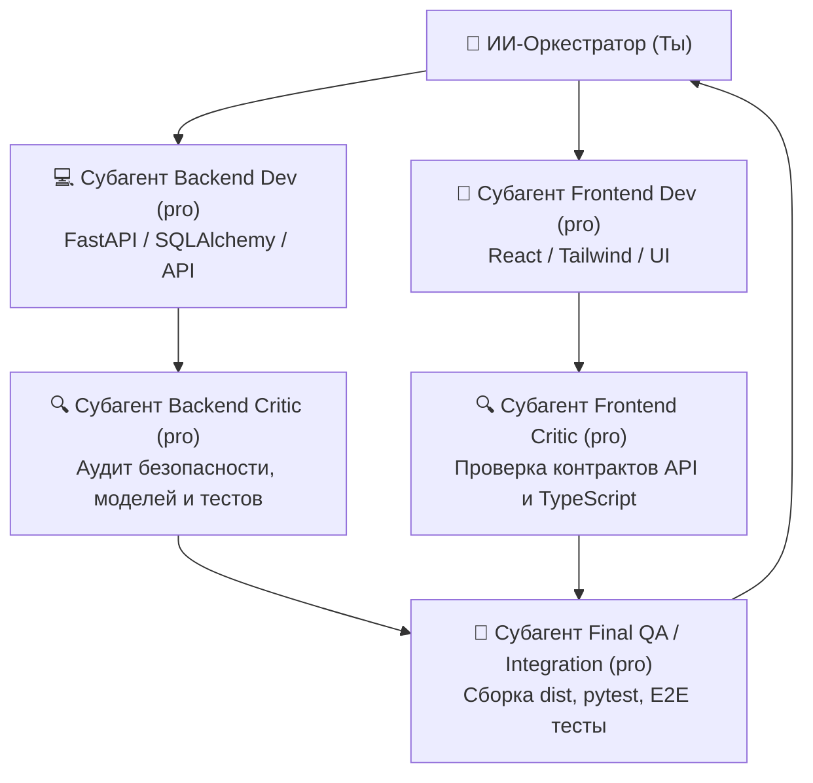

# 🤖 AI Development Guide — KaloriiAI

> Этот файл предназначен для AI-ассистентов, работающих с проектом.
> **Прочитай этот файл ПЕРВЫМ перед началом любой работы.**

---

## 📌 Что это за проект

**KaloriiAI** — PWA веб-приложение для подсчёта калорий и макронутриентов (КБЖУ) с распознаванием еды по фото через AI.

- **Бэкенд:** FastAPI (Python 3.12) + SQLite + SQLAlchemy + Alembic
- **Фронтенд:** React 18 + TypeScript + Vite + Tailwind CSS + Zustand + Recharts
- **AI:** Мультипровайдер (Gemini API + OpenRouter) с fallback-цепочкой
- **Деплой:** Caddy reverse proxy → FastAPI на порту 5100, статика React
- **Домен:** `kalorii.lopni.fun`
- **Сервер:** 62.60.186.12 (Швеция, Ubuntu)

---

## 🏗️ Структура проекта

```
KALORII/
├── backend/              # Python FastAPI бэкенд
│   ├── app/
│   │   ├── main.py       # Точка входа FastAPI
│   │   ├── config.py     # Настройки (pydantic-settings)
│   │   ├── database.py   # Async SQLAlchemy + SQLite
│   │   ├── models/       # ORM модели (user, meal, product, recipe)
│   │   ├── schemas/      # Pydantic v2 схемы
│   │   ├── routers/      # API эндпоинты
│   │   ├── services/     # Бизнес-логика (AI router, nutrition, auth)
│   │   └── utils/        # Утилиты (AI провайдеры, обработка изображений)
│   ├── alembic/          # Миграции БД
│   ├── data/             # Seed данные (products_seed.json)
│   ├── uploads/          # Загруженные фото пользователей
│   ├── .env              # Секреты (API ключи) — НЕ коммитить!
│   └── requirements.txt
│
├── frontend/             # React + TypeScript фронтенд
│   ├── src/
│   │   ├── api/          # HTTP клиент к бэкенду
│   │   ├── components/   # UI компоненты (layout, meals, stats, ai, products, ui)
│   │   ├── pages/        # Страницы (Today, Stats, Profile, Login, Register)
│   │   ├── hooks/        # React хуки
│   │   ├── store/        # Zustand стейт-менеджеры
│   │   ├── types/        # TypeScript интерфейсы
│   │   └── utils/        # Вспомогательные функции
│   ├── public/           # PWA manifest, service worker, иконки
│   └── package.json
│
├── deploy/               # Конфиги деплоя (Caddyfile, systemd, deploy.sh)
├── docs/                 # Документация для AI и разработчиков
│   ├── AI-GUIDE.md       # ← ТЫ ЗДЕСЬ
│   ├── ARCHITECTURE.md   # Архитектурные решения
│   ├── API-REFERENCE.md  # Справка по API эндпоинтам
│   └── CHANGELOG.md      # Лог изменений
│
├── PLAN-KaloriiAI.md     # Исходный план проекта (подробный)
├── AI-MODELS-CATALOG.md  # Каталог AI моделей
└── README.md
```

---

## ⚠️ Правила работы с проектом для AI

### 1. Масштаб изменений определяет подход

| Масштаб | Подход |
|---|---|
| **Маленькое изменение** (баг, правка текста, добавление поля) | Делай сам, без субагентов |
| **Среднее изменение** (новый эндпоинт, новый компонент) | Делай сам или 1 субагент |
| **Большое изменение** (новая фича, рефакторинг) | **ОБЯЗАТЕЛЬНО** используй субагентов |
| **Очень большое** (новый модуль, переписывание) | **Субагенты-разработчики + субагенты-критики** |

### 2. Стратегия субагентов для большой разработки

> [!IMPORTANT]
> **Золотое правило для ИИ в этом проекте:**
> Если задача требует создания новых сущностей, страниц, связок API или рефакторинга — **НЕ пиши всё самостоятельно в одном контекстном окне**. 
> Твоя роль — **главный архитектор и оркестратор**. Ты должен распределять работу между параллельными субагентами (модель `pro` с максимальным reasoning), а затем **обязательно** запускать субагентов-критиков для перекрёстной проверки и исправления ошибок.



#### Протокол оркестрации по шагам:
1. **Шаг 1: Формирование ТЗ для разработчиков**:
   - Чётко сформулируй задачи отдельно для бэкенда и фронтенда.
   - Запусти 2 параллельных субагента через `invoke_subagent` с `Model: "pro"`.
2. **Шаг 2: Мониторинг выполнения**:
   - Установи таймер через `schedule` и жди уведомлений о завершении (не используй холостой цикл `status`).
3. **Шаг 3: Запуск критиков (Code Review & QA)**:
   - Как только разработчики закончили, **обязательно** запусти субагентов-критиков.
   - Критик не просто пишет отчёт — он **обязан сразу исправить найденные ошибки** прямо в файлах проекта.
   - Проверяй согласованность контрактов: пути URL, имена полей в схемах Pydantic и интерфейсах TypeScript, форматы дат и параметров.
4. **Шаг 4: Контрольная верификация**:
   - Запуск `npm run build` в `frontend` (должно быть 0 ошибок).
   - Запуск `pytest` в `backend` (все тесты обязаны проходить).
   - Проверка реального вызова AI Vision с живыми ключами.
5. **Шаг 5: Документирование**:
   - Обязательно обнови `docs/CHANGELOG.md` и соответствующие разделы документации.

---

## 📜 История этапов разработки проекта (Как проект создавался)

Чтобы понимать, как устроен проект, изучи историю прошедших волн:

### Волна 1: Базовый фундамент (MVP)
- **Backend Developer (`pro`)**: Создал полную структуру FastAPI, модели БД (Users, Meals, Products, Recipes, RecipeItems, WeightLog), Alembic миграции, JWT auth, сидирование 55 базовых продуктов и 20 интеграционных тестов.
- **Frontend Developer (`pro`)**: Создал каркас React 19 + TypeScript + Vite + Tailwind CSS, 3 вкладки навигации, состояние Zustand, экраны Today, Stats, Profile, Login, Register, Recharts графики.

### Волна 2: Первая ревизия критиков (Contract Alignment)
- **Backend Critic (`pro`)**: Исправил 14 проблем, включая формат `AuthResponse`, поддержку токенов в заголовках и JSON, формулу Mifflin-St Jeor, безопасный парсинг чисел из LLM, автоудаление файлов фото при удалении еды.
- **Frontend Critic (`pro`)**: Устранил 6 расхождений контрактов API и 5 багов (двойной `/uploads/uploads/`, разбор дат без сдвигов часовых поясов, соответствие полей Pydantic схем).

### Волна 3: Сквозная интеграция и окружение
- **Integration Tester (`pro`)**: Развернул виртуальное окружение `uv` / `.venv`, накатил миграции SQLite, запустил сервер на порту 5100, протестировал 10 реальных HTTP-запросов и подготовил скрипты деплоя Caddy и systemd.

### Волна 4: Полная готовность (v1.0.0)
- **Frontend Polish Developer (`pro`)**: Реализовал 4-ю вкладку рецептов в `AddMealModal`, список рецептов `RecipeList` с фильтром избранного, создание рецептов `CreateRecipeModal`, сохранение еды в рецепты из карточки, интерактивную панель управления приоритетами AI в профиле, генерацию PNG-иконок PWA (192x192 и 512x512).
- **Backend Resilience Developer (`pro`)**: Актуализировал цепочку `DEFAULT_MODEL_CHAIN` (приоритет скоростной `gemini-3.5-flash-lite`), устранил задержки при 429 rate limit, добавил фильтрацию блоков `<thought>` и провел E2E тест реального распознавания еды с живым ключом Gemini API (1.8 сек отклик).
- **Final QA Auditor (`pro`)**: Провёл аудит целостности связей `Product <-> RecipeItem`, исключил утечки сессий в `toggle_favorite`, связал заголовки пользовательских API-ключей с бэкендом и подтвердил оценку **9.8 / 10 (100% Production Ready)**.

### Волна 5: Нативный Android APK (v1.4.0) и Аудит + UX 100г + Умный AI-ассистент (v1.5.0)
- **Capacitor 8 Android (`v1.4.0`)**: Полная упаковка в нативный APK (`kalorii-ai.apk`), системная камера/галерея (`@capacitor/camera`), WebRTC сканер штрихкодов в WebView, тактильный отклик (`@capacitor/haptics`), перехват кнопки «Назад», офлайн-кеш и очередь синхронизации (`frontend/src/utils/platform.ts`).
- **Аудит безопасности и UX v1.5.0 (`2026-10-23`)**:
  - Единое шифрование ключей и токенов (`backend/app/utils/security.py`), защита от SSRF в `barcode_service.py`, потоковое чтение загрузок в `image.py`, учёт `X-Real-IP`/`X-Forwarded-For` в Rate Limiter, очистка чувствительных кешей при `logout()`.
  - Двухшаговый ручной ввод **«На 100 г (с упаковки) + Вес порции»** с долями упаковки и живым пересчётом (`AddMealModal.tsx`, `ProductSearch.tsx`, `CreateRecipeModal.tsx`).
  - Авто-перенос фото этикетки КБЖУ прямо в поля формы «На 100 г» через AI OCR (`BarcodeScannerView.tsx`, `AddMealModal.tsx`).
  - Слайдер и быстрые кнопки масштабирования всей порции (`×0.5..×2.5`, шаги в граммах) без потери точности (`EditMealModal.tsx`, `MealCard.tsx`).
  - Сценарии AI-меню в 1 клик (`🍳 1 блюдо под остаток`, `💪 Добрать белок`, `🥗 Остаток дня`, `📅 Полный рацион`) и быстрые теги пожеланий (`TodayPage.tsx`, `MealPlanPage.tsx`).

### 3. Контекстные файлы и папки заметок — ЧИТАЙ ИХ

Перед работой ОБЯЗАТЕЛЬНО прочитай:
- `docs/AI-GUIDE.md` (этот файл) — общий контекст
- `docs/CHANGELOG.md` — полный хронологический лог всех релизов (`v0.1.0` .. `v1.5.0`)
- `сделано/` — подробные технические спецификации и отчёты о выполненных этапах:
  - `сделано/01_kalorii_bugs_and_security_fixes_spec.md`
  - `сделано/02_kalorii_new_features_ai_planner_and_tg_voice_spec.md`
  - `сделано/03_v1.5.0_security_audit_100g_ux_and_smart_ai_assistant.md`
- `надо сделать/ROADMAP_AND_FUTURE_IDEAS.md` — бэклог идей для будущих релизов
- `docs/ARCHITECTURE.md` и `docs/DEPLOYMENT.md` — архитектура и деплой на сервер `62.60.186.12` (`/opt/kalorii`)

### 4. Важная особенность: как обновляются Сайт и Мобильное приложение (Android APK)

- **Веб-версия (`https://kalorii.lopni.fun`)**: раздаётся контейнером `kalorii` из папки `backend/static/`. После изменений во `frontend/` нужно выполнить `npm run build:sync-static` и пересобрать/перезапустить контейнер на сервере `62.60.186.12` в `/opt/kalorii`.
- **Android-приложение (`kalorii-ai.apk`)**: работает на базе Capacitor с локальным бандлом `webDir: 'dist'` внутри самого APK, а к серверу обращается только по API (`https://kalorii.lopni.fun/api`). Поэтому:
  - Изменения **бэкенда и AI-логики** применяются в мобильном приложении **сразу** после выкатки на сервер.
  - Изменения **интерфейса (React/TS/CSS)** требуют пересборки `kalorii-ai.apk` (скрипт `scripts/build_apk_docker.sh` на сервере или `scripts/build_apk_docker.ps1`) и установки нового APK поверх старого (ключ подписи `kalorii-release-key.jks` единый, поэтому данные и авторизация сохраняются). Свежий APK также кладётся в `backend/static/kalorii-ai.apk` для скачивания из профиля на сайте.

### 4. После завершения работы

**ВСЕГДА обновляй:**
- `docs/CHANGELOG.md` — добавь запись о том что сделал
- `docs/ARCHITECTURE.md` — если изменил архитектуру
- Этот файл — если изменил процесс разработки

---

## 🔑 Секреты и конфигурация

- **API ключи** хранятся в `backend/.env` (НЕ коммитить!)
- **Gemini API Key** — бесплатный ключ Google AI Studio
- **OpenRouter API Key** — бесплатный ключ OpenRouter
- **JWT Secret** — секрет для подписи токенов
- Шаблон: `backend/.env.example`

---

## 🚀 Как запустить локально

### Бэкенд:
```bash
cd backend
python -m venv venv
source venv/bin/activate  # Windows: venv\Scripts\activate
pip install -r requirements.txt
alembic upgrade head
uvicorn app.main:app --host 127.0.0.1 --port 5100 --reload
```

### Фронтенд:
```bash
cd frontend
npm install
npm run dev
```

Фронтенд на `http://localhost:5173`, проксирует `/api` на `localhost:5100`.

---

## 🎨 Дизайн-система

| Элемент | Значение |
|---|---|
| Тема | Тёмная (dark mode only) |
| Фон основной | `#0f0f0f` |
| Фон карточек | `#1a1a1a` / `#262626` |
| Акцент | `emerald-500` / `green-500` |
| Шрифт | system-ui, Inter |
| Скругления | `rounded-lg` / `rounded-xl` |
| Навигация | Нижняя панель, 3 вкладки |
| Мобильная ширина | 360-428px (приоритет) |

---

## 📡 API контракт (ключевые эндпоинты)

| Метод | Путь | Описание |
|---|---|---|
| POST | `/api/auth/register` | Регистрация |
| POST | `/api/auth/login` | Логин → JWT |
| GET | `/api/meals?date=YYYY-MM-DD` | Еда за день |
| POST | `/api/meals` | Добавить приём пищи |
| PUT | `/api/meals/{id}` | Редактировать |
| DELETE | `/api/meals/{id}` | Удалить |
| POST | `/api/ai/recognize` | Фото → КБЖУ через AI |
| GET | `/api/products?search=...` | Поиск продуктов |
| GET | `/api/stats?period=week` | Статистика |
| GET/PUT | `/api/profile` | Профиль |
| POST | `/api/profile/calculate` | Авторасчёт КБЖУ |
| POST | `/api/profile/weight` | Записать вес |

---

## 🧠 Политика и соглашения для AI Vision провайдеров

1. **Приоритеты цепочки моделей (`DEFAULT_MODEL_CHAIN`)**:
   - Топовая модель: `("gemini", "gemini-3.5-flash-lite")` — обеспечивает наивысшую скорость отклика и стабильную доступность.
   - Fallback-цепочка: `gemini-3.8-flash` → `gemini-3.7-flash` → `google/gemma-4-26b-a4b-it:free` → `openrouter/free`.
2. **Обработка Reasoning и Thinking блоков**:
   - Google Gemini может возвращать мульти-партовые ответы с частями `thought: True` / `thinking: True`.
   - Провайдер обязан игнорировать любые thought-части и парсить JSON только из чистых текстовых частей.
   - Инлайн-теги `<thought>...</thought>`, `<thinking>...</thinking>`, `<think>...</think>` должны вырезаться перед извлечением JSON.
3. **Реакция на Rate Limit (HTTP 429)**:
   - При получении `AIRateLimitError` роутер **не должен** ожидать 5 секунд перед повтором той же модели.
   - Роутер обязан немедленно переходить к следующей модели в цепочке для мгновенного ответа пользователю.
4. **Устойчивость OpenRouter**:
   - Если бесплатная модель отклоняет `response_format: {"type": "json_object"}`, провайдер автоматически повторяет запрос без этого параметра и парсит JSON с помощью `extract_json_from_text`.

